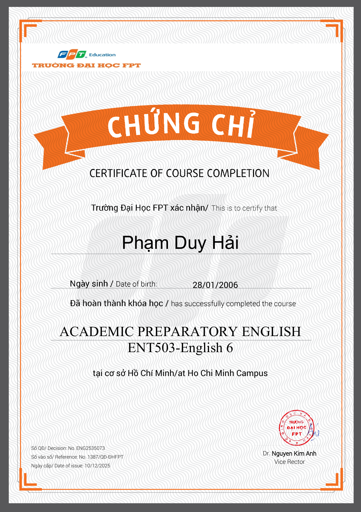

<h1 align="center">Hi, I'm Phạm Duy Hải 👋</h1>

  Software Engineering student @ <b>FPT University (HCMC)</b> · Aspiring <b>Full-stack Developer</b>

  
  

---

### 🙋‍♂️ About Me

- 🎓 Software Engineering student at **FPT University**, Ho Chi Minh City Campus
- 🏅 **Honorable Student of Trimester** – Summer 2026
- 💻 Interested in both **backend** and **frontend** development
- 🚀 Currently building **DH tech**, a full-stack phone e-commerce website
- 📚 Currently learning: Java Web (Servlet/JSP, MVC), Data Structures & Algorithms, Software Requirements
- 💼 Open to **internship** opportunities
- 📫 Reach me at **hp24122015@gmail.com**

### 🛠️ Tech Stack

**Frontend**

  

**Backend & Database**

  
   
  
  

**Cloud & Deployment**

  
  
  
  

**Tools**

  

### 📌 Featured Project

#### 📱 [DH tech](https://github.com/28thHidro/dh-tech) · [dhtech.id.vn](https://dhtech.id.vn)
My first full-stack web project: an e-commerce website for phones, laptops and accessories, with a customer storefront, an admin dashboard, and its own REST API and database.

| Layer | Technology |
|---|---|
| Frontend | React 19, Vite, React Router · deployed on **Vercel** with custom domain |
| Backend | Node.js, Express 5, JWT auth, bcrypt · deployed on **Render** |
| Database | PostgreSQL on **Neon** |
| Media | **Cloudinary** (signed image uploads) |

**Highlights:** customer accounts & order tracking · admin CRUD for products, variants, SKU stock and specs · brand/price filters and live search · responsive UI with dark mode · admin login lockout after 5 failed attempts

### 🌐 Languages

- 🇻🇳 **Vietnamese** — Native
- 🇬🇧 **English** — Completed Academic Preparatory English (ENT503) at FPT University
- 🇯🇵 **Japanese** — Basic communication (completed JPD113, JPD123 at FPT University)

### 🏆 Achievements & Certificates

| | |
|:---:|:---:|
|  |  |
| **Honorable Student of Trimester – Summer 2026** FPT University · Issued 28/10/2026 | **Academic Preparatory English (ENT503 – English 6)** FPT University, HCMC Campus · Issued 10/12/2025 |

### 📊 GitHub Stats

  
  

